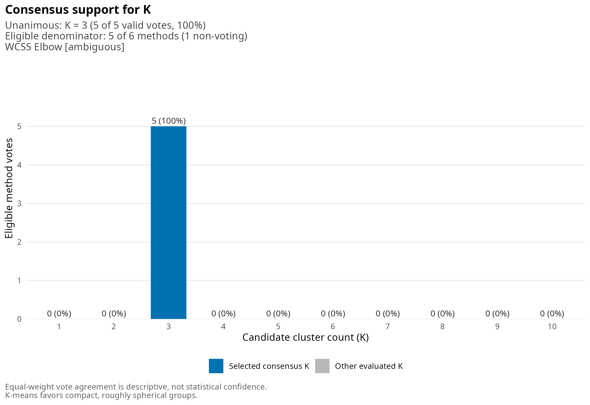
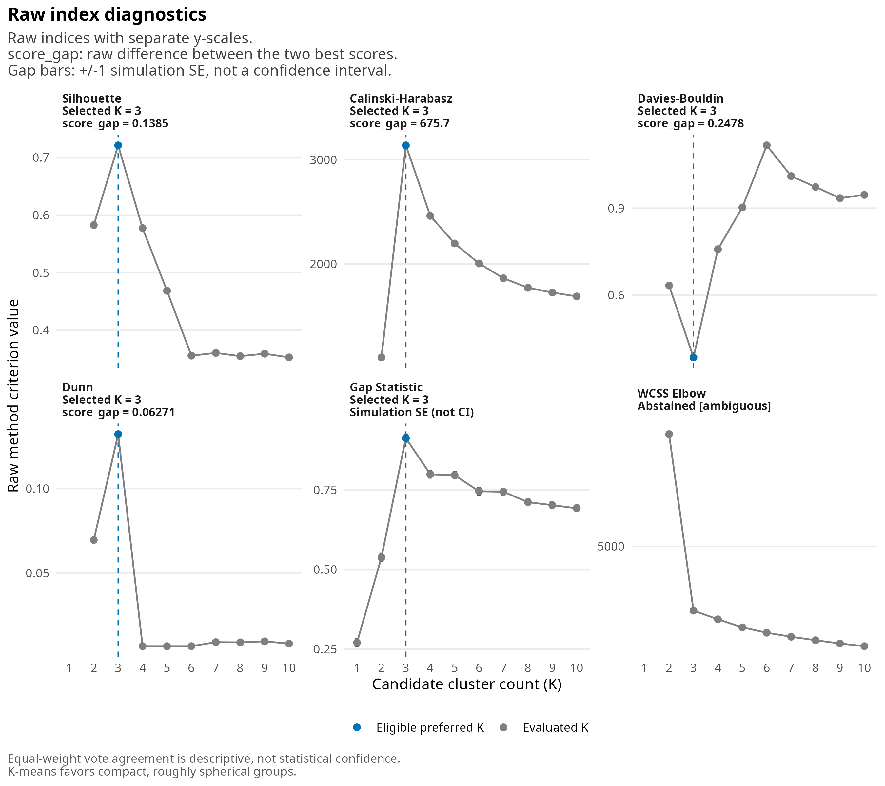
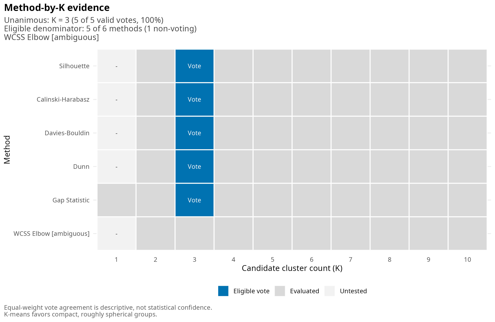

# kconsensus: implementation and validation showcase

**Development version:** 0.0.0.9000  
**Work documented:** November 5, 2026  
**Status:** implemented and software-checked; statistical limitations remain explicit.

> This document was prepared with AI assistance from the project source,
> executed analyses, saved results and package-check logs. It has not been
> comprehensively reviewed by a human analyst. Passing software checks is not
> a certification of statistical performance or release readiness.

## Overview

`kconsensus` compares candidate K-means cluster counts using several evaluation
methods. It keeps their recommendations, disagreements and raw score curves
visible. It does not turn a vote percentage into a probability that a cluster
count is correct.

The work covered the calculation engine, consensus rules, three plotting views,
software tests, a repeated-data simulation study, a supplied benchmark suite,
and a separate Gap seed-stability study.

| Evidence layer | Completed work | What it establishes |
|---|---|---|
| Unit tests | 563 assertions passed, without warnings | The tested implementation contracts hold |
| Separate-session package check | 0 errors, 0 warnings, 0 notes | The package passes the recorded development check |
| Repeated-data study | 600 generated datasets; 700 consensus evaluations | Behavior under six specified designs and a paired K-range comparison |
| Supplied benchmark | 19 valid runs and five expected-error cases | Reference agreement, input rejection and behavior on the supplied fixtures |
| Gap stability | 30 runs on two fixed controls | Stability across five seeds and three reference-simulation counts |

These layers are not interchangeable. Correct calculations can still produce
an unsuitable cluster count for a particular scientific question.

## Contents

[Calculation engine](#calculation-engine) ·
[Consensus engine](#consensus-engine) ·
[Public interface](#public-interface) ·
[Visual showcase](#visual-showcase) ·
[Software verification](#software-verification) ·
[Repeated-data study](#repeated-data-study) ·
[Supplied benchmark](#supplied-benchmark) ·
[No-cluster controls](#why-gap-disagrees-on-the-no-cluster-controls) ·
[Gap stability](#gap-stability-study) ·
[Reproduction and artifacts](#reproduction-and-artifacts) ·
[Remaining limitations](#remaining-limitations-and-next-work)

## Calculation engine

### Strict input validation

[R/validate_input.R](R/validate_input.R) rejects invalid inputs rather than
trying to repair them. Inputs must be a real numeric matrix or a data frame
containing only numeric vector columns. They must have at least one variable,
at least three observations, and no missing, infinite or nonnumeric values.

Candidate cluster counts must be distinct, finite whole numbers. For the
internal indices they must satisfy:

$$
2 \le K < n, \qquad K \le n_{\text{distinct points}}.
$$

Duplicate observations are allowed when enough distinct points remain.
Constant columns are also allowed and are not silently removed.

The package does **not** standardize variables. A caller who wants that
transformation must supply `scale(x)` explicitly. Scaling a constant column
can create undefined values, which the validator will reject.

The result records `data_used_as_supplied = TRUE` and
`standardized_by_package = FALSE`. The second flag describes package behavior;
it does not assert that the caller supplied unscaled data.

### Reusable K-means solutions

[R/fit_clusters.R](R/fit_clusters.R) makes one `stats::kmeans()` call per
candidate K, with 25 random starts and a maximum of 100 iterations. Each call
therefore chooses among multiple initializations; it is not a single-start fit.

The per-K seed is `seed + K`, scoped with `withr::with_seed()`. Candidate order
does not change a candidate's seeded solution, and the caller's random-number
state is restored. The result retains these central fitted partitions in
`result$fits`, named by K.

The four internal indices and WCSS use the same central partitions. Gap is
separate: its observed-data and reference calculations perform additional
clustering fits.

### Evaluation methods

| Method | What is calculated | Current selection rule |
|---|---|---|
| Silhouette | Mean silhouette width from `cluster::silhouette()` | Maximum |
| Calinski-Harabasz | Dispersion criterion from `clusterCrit::intCriteria()` | Maximum |
| Davies-Bouldin | Cluster similarity/dispersion criterion from `clusterCrit` | Minimum |
| Dunn | Separation-to-diameter criterion from `clusterCrit` | Maximum |
| Gap | Improvement relative to simulated reference data | `firstSEmax`, with one simulation SE |
| WCSS / elbow | Stored total within-cluster sum of squares and normalized chord deviation | Unique knee meeting a caller-supplied threshold; otherwise abstain |

[R/compute_indices.R](R/compute_indices.R) constructs `stats::dist(x)` once per
scoring call and reuses it for silhouette calculations across partitions.
`clusterCrit` performs its own internal calculations; not every method consumes
that shared distance object. Distance-based calculations still have quadratic
memory costs and are not yet optional for large datasets.

Nonconverged fits, malformed partitions and non-finite calculated scores
produce informative errors rather than misleading finite substitutes.

### Gap is a separate calculation

[R/compute_gap.R](R/compute_gap.R) uses `cluster::clusGap()` with 100 reference
simulations by default, 25 K-means starts, and 100 maximum iterations.
Its current settings are `d.power = 1` and `spaceH0 = "scaledPCA"`.

The distance power is the historical R default, not the squared-distance
version. The reference-space PCA operation is part of the Gap algorithm; it
does not mean the package automatically standardizes input columns.

Gap evaluates every K from 1 through `max(k)`, even when the caller's internal
candidate vector has gaps. It can recommend K = 1. That recommendation is
retained and remains eligible; it is never silently changed to 2.

`firstSEmax` uses the first local maximum with its SE rule. It is not the same
rule as `Tibs2001SEmax`, and neither is presented as a calibrated hypothesis
test for the existence of clusters.

### Elbow can abstain

[R/compute_elbow.R](R/compute_elbow.R) sorts paired K/WCSS values and normalizes
both axes. It measures how far the curve lies below the endpoint chord and
retains the raw curve, candidate K and knee strength.

The detector does not choose the minimum WCSS. It abstains on flat or
numerically straight curves, ambiguous knees, increasing WCSS, or insufficient
candidate counts. It also abstains by default because
`elbow_min_strength = NULL`.

A supplied threshold is explicitly labelled **user-supplied and uncalibrated**.
Geometric knee strength is not statistical confidence. The tests check the
geometry and abstention behavior; they do not validate a universal cutoff.

## Consensus engine

The aggregation layer receives standardized recommendations, not the internal
formulas of the indices.

Each [method record](R/method_recommendation.R) contains `method`, `preferred_k`,
`status`, `eligible`, `reason`, `scores` and `diagnostics`. The
[adapters](R/recommend_methods.R) create these records from the calculation
outputs. The [voting engine](R/compute_consensus.R) then counts eligible votes.

$$
\operatorname{Agreement}(K) =
100 \times
\frac{\text{eligible methods voting for }K}
{\text{total eligible voting methods}}.
$$

“Valid” means that the method has a defined recommendation. The separate
eligibility flag determines whether that recommendation enters the vote. For
the four internal indices, a unique best score is sufficient for valid status;
no claim about population cluster structure follows from that status.

| Situation | Implemented behavior |
|---|---|
| Unique highest vote count | Return that K and grade its support in `status`: `unanimous`, `majority` (more than half of the valid votes) or `plurality` (most votes, no majority) |
| Tie for highest vote count | Return all tied candidates and `recommended_k = NA` |
| Legitimate ambiguity or undefined method | Exclude its vote and retain the reason |
| Explicitly ineligible method | Exclude it without deleting its evidence |
| No valid votes | Return no recommendation; agreement percentages are `NA` |
| Unique winner at the global highest tested K | Emit and retain an upper-boundary warning and `upper_boundary` flag |
| Winner is the smallest K that every method voting for it evaluated | Add a descriptive `lower_boundary` flag |
| A method votes for K = 1 while others vote for K >= 2 | Add a descriptive `single_cluster_vote` flag; the vote itself is unchanged |
| Method disagreement | Preserve each supplied score curve and diagnostics |

Invalid arguments and data still stop `kconsensus()` before any fitting.
Failures during the calculation do not: a failed or non-converged K-means fit
leaves that K undefined, so the methods that need it abstain; non-finite index
values make only that index abstain; and a Gap failure makes Gap abstain. A
warning lists the failures, and each abstention keeps its reason.

### Worked voting example

This is the arithmetic example used in tests, not the stress-test dataset
shown in the figures below.

| Method | Preferred K | Status |
|---|---:|---|
| Silhouette | 3 | Valid |
| Calinski-Harabasz | 3 | Valid |
| Davies-Bouldin | 4 | Valid |
| Dunn | 3 | Valid |
| Gap | 4 | Valid |
| Elbow | — | Ambiguous; excluded |

K = 3 receives 3/5 = 60% agreement; K = 4 receives 2/5 = 40%.

### Score closeness stays visible

Exact best-score ties cause abstention. Near-ties still cast one vote, but the
diagnostics retain the best score, runner-up score and raw difference.
For example, silhouette scores 0.501 and 0.500 produce a gap of 0.001, whereas
0.65 and 0.31 produce 0.34. Both give one vote, but they tell different stories.

Those differences remain in their own method's units. They are not combined
into an arbitrary normalized “confidence” score. The methods also summarize
related properties of the same data; they are not independent hypothesis tests.

## Public interface

Run the following from the project root in a development session:

```r
devtools::load_all()

x <- as.matrix(utils::read.csv(
  "data_test/kconsensus_benchmark/data/cluster_stress_test.csv"
))

result <- kconsensus(
  x,
  k = 2:10,
  seed = 6749L,
  B = 100L,
  elbow_min_strength = NULL
)

result            # short overview
summary(result)   # support, runner-up, abstentions, flags and caveats

result$recommended_k
as.data.frame(result)                      # one row per method
as.data.frame(result, what = "scores")     # every method score at every K
```

This reproduces the recorded stress-test configuration. Reproducibility
assumes compatible R, package and RNG settings; recorded studies include
session information.

| Result field | Contents |
|---|---|
| `recommended_k`, `tied_candidates`, `status` | Decision or explicit lack of one, with graded support (`unanimous`, `majority`, `plurality`, `tie`, `no_valid_votes`) |
| `flags` | Descriptive notes: `upper_boundary`, `lower_boundary`, `single_cluster_vote` |
| `agreement` | Votes and agreement percentage for every evaluated candidate |
| `methods` | Recommendations, eligibility, inclusion, reasons and range endpoints |
| `recommendations` | Full per-method score curves and diagnostics |
| `n_valid_methods` | Actual voting denominator |
| `boundary_warning` | Upper tested-range warning flag |
| `fits` | Central K-means solutions, named by K |
| `settings` | Candidate vector, seed, B and elbow threshold |
| `preprocessing` | Supplied-data and no-package-standardization flags |

The exact tested candidate set is available in each method's `scores$k`;
range endpoints alone need not describe a sparse candidate set.

## Visual showcase

All three public views return ordinary ggplot objects:

```r
plot(result, type = "consensus")
plot(result, type = "indices")
plot(result, type = "matrix")
```

The figures below were exported from the **saved, actual stress-test result**,
not invented example scores. That fixture contains four generating groups
and 30 outliers among 750 observations. Consensus selects K = 3, with five
eligible votes and 100% agreement. Inlier adjusted Rand index is 0.924, not
perfect recovery. This is a useful demonstration of why unanimity is not truth.

### A. Consensus voting chart



The bar heights are vote counts. Labels also show percentages. The subtitle
states the denominator and exclusions, and one accent color marks the selected
candidate. Ties are displayed as ties rather than given a hidden tie-break.

### B. Diagnostic index curves



Each panel uses its own raw y-scale. The internal-index panels show raw
best-versus-runner-up differences. Gap bars represent simulation SE, **not
confidence intervals**. WCSS remains visible when elbow abstains.

Missing scores are not replaced with invented numeric values. Their positions
and unavailable status are indicated, and lines do not bridge missing scores.

### C. Method-by-K evidence matrix



The matrix distinguishes votes, evaluated candidates, undefined scores,
excluded preferences and untested candidates. An elbow knee candidate does not
become a vote when the method has abstained. The current matrix is not a
normalized score heatmap.

### Customize or save a plot

```r
plot(result, type = "consensus") +
  ggplot2::labs(title = "My cluster-count comparison") +
  ggplot2::theme(legend.position = "none")

ggplot2::ggsave(
  "consensus.pdf",
  plot = plot(result, type = "consensus"),
  width = 9,
  height = 6.2
)
```

Every view carries the general caveat that K-means favors compact, roughly
spherical groups. No data-triggered shape detector has been claimed.

## Software verification

The latest recorded unit-test run passed **422 assertions**, with zero failures,
warnings or skips. Tests cover reference values on the same partitions,
candidate validation, score ties, voting denominators, abstentions, RNG-state
preservation, reproducibility, plot data and public S3 dispatch.

Additional checks cover rotation/uniform-scale invariance, duplicates,
constant features, invalid K, undefined criteria, retained fits and plot edge
cases. Statistical recovery is not reduced to a blanket unit-test assertion
that every generated dataset must return its generating K.

The development commands were run, including a package check in a separate R
session:

```r
devtools::load_all()
devtools::test()
devtools::document()

dir.create(".checks", showWarnings = FALSE)
devtools::check(check_dir = normalizePath(".checks"), error_on = "never")
```

The check completed with **0 errors, 0 warnings and 0 notes** under R 4.6.1.
The recorded devtools invocation used `--no-manual --as-cran`; this is not a
claim of CRAN acceptance or PDF-manual validation. The
[check log](.checks/kconsensus.Rcheck/00check.log) is retained locally.

The project-local check folder was used after the environment blocked creation
of a check folder in the supplied scratch location. Local check artifacts,
validation studies and supplied benchmark data are excluded from package builds.

## Repeated-data study

The [Monte Carlo study](validation/README.md) generated 100 datasets for each
of six scenarios, with 120 observations per dataset. A paired extended-range
comparison on overlapping data brought the total to **700 evaluations on 600
generated datasets**. Each dataset used 100 Gap reference simulations.

| Scenario | K range | K = 3 recovery | Median adjusted Rand index | Ties |
|---|---|---:|---:|---:|
| Separated Gaussian groups | 2:6 | 100/100 | 1.000 | 0 |
| Overlapping groups | 2:6 | 3/100 | 0.209 | 30 |
| Overlapping groups | 2:15 | 1/100 | 0.074 | 25 |
| One very small group | 2:6 | 0/100 | 0.917 | 0 |
| Elongated groups | 2:6 | 0/100 | 0.268 | 24 |
| High-dimensional noise | 2:6 | 0/100 | 0.555 | 0 |
| Uniform data | 2:6 | Not defined | Not defined | 17 |

Recovery counts include ties as non-recoveries. Adjusted Rand medians are
conditional on a unique recommendation because ties have no selected partition.
Adjusted Rand index measures label-invariant partition agreement, adjusted
for chance; 1 indicates an exact match. It can conceal poor recovery of a rare
group when most observations belong to large groups.

In the small-group design, sizes were 55, 60 and 5. Every repetition selected
K = 2. Median best-matching F1 for the rare group was only **0.116**, despite
median adjusted Rand index 0.917. Thus, a good aggregate score did not establish
small-group recovery.

The separated-data recovery interval was 96.3% to 100% using a 95% Wilson
interval. That interval describes repeated datasets from the specified
generator, not the probability that a real dataset has three groups.

Expanding the overlapping-data range from 2:6 to 2:15 changed the recommendation
or tied set in **90/100 paired repetitions**. This comparison reused the same
central fits and reference simulations, so it isolated candidate-range changes
from changes in the reference samples.

Uniform data sometimes produced unanimous voting despite lacking discrete
generating groups. There were no calculation errors in the 700 evaluations;
the statistical failure modes were retained rather than treated as software
errors or hidden by tuning.

## Supplied benchmark

The supplied collection in
[data_test/kconsensus_benchmark](data_test/kconsensus_benchmark) was tested
without modifying its data or generation scripts. Its proposed `choose_k()`
example was replaced by a separate validation runner using the implemented
`kconsensus()` API; the original example itself was left unchanged.

There were **24 jobs**: 18 valid fixtures at 2:10, a second `many_12` run at
2:15, and five intended invalid cases. All 19 valid runs matched their reference
score, WCSS, voting and Gap-selection checks. All three plotting views built
for each valid result. All five invalid cases failed for the expected reason.

All 16 supplied truth files aligned with their feature rows. Features alone
entered clustering; labels remained separate. The 60 duplicated observations
and the constant feature were retained.

| Fixture | K range | Consensus result | Agreement | Inlier adjusted Rand index |
|---|---|---|---:|---:|
| `clear_3` | 2:10 | 3 | 100% | 1.000 |
| `clear_5` | 2:10 | 5 | 100% | 1.000 |
| `cluster_stress_test` | 2:10 | 3 | 100% | 0.924 |
| `unbalanced_4` | 2:10 | 4 | 60% | 1.000 |
| `high_dim_noise_3` | 2:10 | 2 | 80% | 0.530 |
| `many_12` | 2:10 | 10; upper-bound warning | 100% | 0.840 |
| `many_12` | 2:15 | Tie: 10 and 13 | 40% each | Not defined |

For contaminated fixtures, the primary recovery metric excludes truth label
-1 **only when scoring recovery**. All rows remain in clustering. A secondary
all-row metric treats -1 as one category and is reported as a sensitivity
analysis. For the stress fixture, the secondary adjusted Rand index was 0.865.

Recovery is evaluated on the retained central partition at the selected K,
including when Gap supplies that K. Generating labels are not certified optimal
cluster counts for every criterion.

The unbalanced fixture recovered its four groups, including an 11-observation
group. This does not contradict the earlier small-group failure: group size,
separation and placement differ between the designs.

Rings and moons each selected K = 10 with an upper-bound warning, with adjusted
Rand indices 0.238 and 0.198. Their geometric groups are poorly recovered by
these K-means partitions. `overlap_3` and the 2:10 `many_12` run also triggered
upper-bound warnings.

For `outliers_3`, Dunn tied exactly and abstained; four methods voted and the
winner received 50% agreement. The extended `many_12` run had non-monotonic
fitted WCSS, which was retained and caused elbow to abstain. Approximate
K-means solutions are not forced into a monotone WCSS curve.

The two supplied `many_12` runs used separate complete Gap calculations with
the same base seed. Unlike the earlier paired Monte Carlo comparison, their
reference streams were not held common. The single pair therefore does not
isolate range effects from reference-stream differences.

See the [full supplied-benchmark report](validation/SUPPLIED_BENCHMARK.md) and
[complete results](validation/supplied_benchmark_summary.csv).

## Why Gap disagrees on the no-cluster controls

The supplied uniform and single-Gaussian controls expose a structural
limitation, not a vote-counting or reference-score mismatch.

| Method | Uniform control | Single Gaussian |
|---|---:|---:|
| Silhouette | 4 | 2 |
| Calinski-Harabasz | 9 | 2 |
| Davies-Bouldin | 6 | 6 |
| Dunn | 6 | 10 |
| Gap | 1 | 1 |
| Consensus | 6, with 40% | 2, with 40% |

Both outcomes are now reported with `status = "plurality"` (no majority) and
carry the `single_cluster_vote` flag, rather than as plain winners.

The internal indices answer: **Which tested subdivision ranks best?** They do
not establish that subdivision is warranted. They cannot evaluate K = 1 and
currently abstain on exact score ties, not merely on weak evidence of structure.
Uniform data can therefore receive a preferred geometric partition. A single
correlated Gaussian can also be divided into apparently compact groups.

The uniform silhouette preference was marginal: 0.411615 at K = 4 versus
0.409225 at K = 6, a difference of 0.002390. The raw diagnostic exposes that
closeness without turning it into a calibrated uncertainty score.

Gap has a different reference-based comparison and can choose 1. Its K = 1
vote is counted correctly. However, with the current built-in defaults, it is
the only eligible method capable of choosing 1. Its single vote cannot be a
**unique** winner while any other method votes for K >= 2: it either loses or
ties. Making K = 1 eligible did not, by itself, create an effective no-clusters
decision procedure.

On uniform data, the configured local rule selected K = 1 even though the
global Gap maximum occurred at K = 7. This motivated a stability check before
adding any new warning or decision rule.

## Gap stability study

The full stability plan was reduced to a five-seed preliminary study after a
runtime pilot. Both supplied controls stayed fixed: 600 uniform observations
and 550 Gaussian observations, each with two features. K = 1:10, distance power,
reference space and selection rule also stayed fixed.

The seeds were **8614, 4544, 8592, 6666 and 4549**, generated reproducibly rather
than chosen to give a desired outcome.

| Reference simulations B | Uniform: selected K = 1 | Gaussian: selected K = 1 |
|---:|---:|---:|
| 100 | 5/5 | 5/5 |
| 500 | 5/5 | 5/5 |
| 1,000 | 5/5 | 5/5 |

All **30 runs completed without failures or warnings**. Dataset and
implementation hashes matched across batches. The observed log(W) curves were
identical across B within each dataset/seed pair; this is a dispersion check,
not a direct comparison of partition labels.

The uniform global-maximum rule still selected 7 in every run, and the global
SE rule selected 3. The configured `firstSEmax` and the separate
`Tibs2001SEmax` rule selected 1 throughout. On Gaussian data, all four rules
selected 1. No alternative rule was adopted after seeing these results.

Increasing B improved precision without changing the configured decision.
Gap's reported simulation quantity is:

$$
\mathrm{SE.sim} = s_{\log W^*}\sqrt{1 + 1/B}.
$$

The Monte Carlo standard error of the reference **mean** is instead:

$$
\mathrm{MCSE}(\overline{\log W^*}) =
\frac{\mathrm{SE.sim}}{\sqrt{B+1}}.
$$

For K = 1, mean estimated MCSE across seeds fell from about 0.00132 to 0.00042
for uniform data and from 0.00153 to 0.00047 for Gaussian data as B increased
from 100 to 1,000. `SE.sim` stayed near 0.013 and 0.015 respectively; it should
not shrink like a standard error of the mean.

These results show no detected seed/B selection instability for the two fixed
controls. They do **not** estimate a population false-positive rate, prove
stability for other datasets, or certify a no-clusters test. Five seeds can
miss infrequent changes, and observed-data K-means fits at K >= 2 can also vary
across seeds.

See the [Gap stability report](validation/GAP_STABILITY.md),
[summary](validation/gap_stability_summary.csv) and
[individual runs](validation/gap_stability_trials.csv).

## Reproduction and artifacts

The full studies are separate from routine unit tests because they are
computationally expensive. All input paths below are relative to the project
root. Stored results include session information.

| Study | Runner | Detailed explanation | Saved full results |
|---|---|---|---|
| Repeated-data behavior | [run_statistical_behavior.R](validation/run_statistical_behavior.R) | [validation/README.md](validation/README.md) | [statistical_behavior.rds](validation/statistical_behavior.rds) |
| Supplied benchmark | [run_supplied_benchmark.R](validation/run_supplied_benchmark.R) | [SUPPLIED_BENCHMARK.md](validation/SUPPLIED_BENCHMARK.md) | [supplied_benchmark.rds](validation/supplied_benchmark.rds) |
| Gap stability | [run_gap_stability.R](validation/run_gap_stability.R) | [GAP_STABILITY.md](validation/GAP_STABILITY.md) | [gap_stability.rds](validation/gap_stability.rds) |

CSV summaries and per-run files are stored alongside those RDS files. The RDS
artifacts preserve fuller evidence, including method curves and settings.

### Inspect saved results without rerunning simulations

```r
devtools::load_all()
benchmark <- readRDS("validation/supplied_benchmark.rds")
index <- which(
  benchmark$summary$scenario == "cluster_stress_test" &
    benchmark$summary$k_max == 10L
)
stopifnot(length(index) == 1L)
result <- benchmark$results[[index]]$result

plot(result, type = "consensus")
plot(result, type = "indices")
plot(result, type = "matrix")
```

The embedded PNGs were generated from that saved result at 300 dpi. They can be
regenerated without new reference simulations:

```r
sizes <- list(consensus = c(9, 6.2), indices = c(9, 8), matrix = c(9.5, 6.2))
dir.create("man/figures", recursive = TRUE, showWarnings = FALSE)

for (type in names(sizes)) {
  ggplot2::ggsave(
    file.path("man/figures", paste0("showcase-", type, ".png")),
    plot = plot(result, type = type),
    width = sizes[[type]][1], height = sizes[[type]][2],
    units = "in", dpi = 300, bg = "white"
  )
}
```

### Source map

| Source file | Responsibility |
|---|---|
| [R/kconsensus.R](R/kconsensus.R) | Public calculation interface and retained fits |
| [R/validate_input.R](R/validate_input.R) | Strict input validation |
| [R/fit_clusters.R](R/fit_clusters.R) | Seeded, reusable central K-means solutions |
| [R/compute_indices.R](R/compute_indices.R) | Four internal indices and stored WCSS |
| [R/compute_gap.R](R/compute_gap.R) | Reference simulations and Gap selection |
| [R/compute_elbow.R](R/compute_elbow.R) | Normalized knee diagnostics and abstention |
| [R/method_recommendation.R](R/method_recommendation.R) | Standardized recommendation records |
| [R/recommend_methods.R](R/recommend_methods.R) | Method-specific adapters and raw score margins |
| [R/compute_consensus.R](R/compute_consensus.R) | Method-agnostic equal-weight voting |
| [R/plot.R](R/plot.R) | Three public ggplot views |

## Remaining limitations and next work

| Open item | Current position |
|---|---|
| Gap-consensus disagreement diagnostic | Implemented as the descriptive `single_cluster_vote` flag. It does not establish that no clusters exist, and it does not change any vote. |
| No-clusters calibration | Not established by seed stability. It needs independently generated null and clustered datasets and explicit error criteria. |
| Elbow cutoff | No validated default. Automatic elbow selection abstains unless the caller supplies an uncalibrated threshold. |
| Model shape | General K-means caveat is displayed. No automatic geometry detector or non-spherical clustering alternative was implemented. |
| Large datasets | Pairwise-distance memory and simulation runtime remain important limits; optional distance-based scoring is not implemented. |
| Calculation failures | Failed fits, undefined indices and Gap failures now become reasoned abstentions with a warning. A method still abstains entirely if any tested K is undefined for it; scoring the remaining K is not implemented. |
| Release metadata | Author name/email are still placeholders. Publication metadata must be completed without inventing identities or URLs. |
| Website and project introduction | The README and the `choosing-k` vignette now introduce the package. The optional pkgdown check needs a real site URL; it was not a passing website validation. |
| Automated formatting | `air` was unavailable. Passing R checks does not mean an automatic formatter ran. |

No warning rule or arbitrary confidence threshold was added as part of the
Gap stability investigation. This Markdown showcase also does not change the
statistical engine.

## Main conclusion

The package now has an auditable calculation pipeline, transparent voting,
reusable plots, reproducible validation artifacts and clean recorded software
checks. The studies also expose real limitations: rare groups can disappear,
non-spherical structure can be partitioned poorly, candidate ranges can drive
the result, and an unclustered cloud can still receive a confident-looking vote
percentage. The appropriate output is therefore **a documented comparison of
methods and evidence—not a claim that consensus reveals the true K**.
