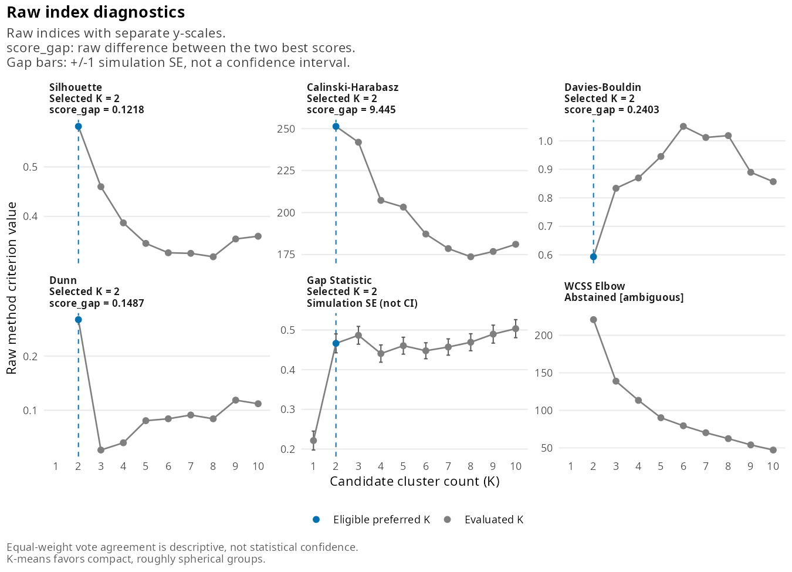

# kconsensus

<!-- badges: start -->
<!-- badges: end -->

kconsensus helps you choose the number of clusters, K, before running
K-means. It runs six common selection methods on the same K-means fits,
counts their votes, and tells you how strong that agreement is. When the honest
answer is "inconclusive", it says so.

Most tools return one number even when the methods disagree. kconsensus keeps
every method's scores, reports which methods did not vote and why, and grades
the vote as unanimous, majority, plurality, single vote, tie or no valid votes.

## Installation

kconsensus is not on CRAN yet. Install it in one of these ways.

From a shared package file (`kconsensus_0.1.0.tar.gz`):

``` r
install.packages(c("cluster", "clusterCrit", "ggplot2", "withr"))
install.packages("path/to/kconsensus_0.1.0.tar.gz", repos = NULL, type = "source")
```

From a copy of the source folder:

``` r
# install.packages("devtools")
devtools::install("path/to/kconsensus", upgrade = FALSE)
```

## Quickest start: the ready-made script

The package includes a script that reads a CSV or Excel file, skips text
columns, constant columns and rows with missing values, chooses K, and saves
the plots, a summary and your data with a `cluster` column next to the file.
Copy it, open it, and click **Source**:

``` r
file.copy(system.file("scripts", "find_k_for_my_data.R", package = "kconsensus"), "find_k.R")
file.edit("find_k.R")
```

Only include columns that should define the groups: unrelated columns dilute
the clusters. List ID, date or code columns in `exclude_columns`.

## Example

``` r
library(kconsensus)

result <- kconsensus(scale(iris[, 1:4]), k = 2:10)
result
#> <kconsensus result>
#> Recommended K: 2  (unanimous: 5 of 5 valid votes, 100%)
#> Votes: K = 2 (5)
#> Use summary() for reasons and flags, and plot() for diagnostics.
```

`summary()` explains the vote:

``` r
summary(result)
#> kconsensus: number of clusters for K-means
#> --------------------------------------------
#> Recommended K:  2
#> Support:        Unanimous (5 of 5 valid votes, 100%)
#> Valid votes:    5 of 6 methods
#> Candidate K:    2:10
#> Seed:           6749
#> K-means starts: 25
#> Gap B:          100
#>
#> Votes
#>   K = 2  5 votes  100%
#>
#> Methods
#>   Method             Vote  Runner-up  Margin
#>   Silhouette         2     3          0.122
#>   Calinski-Harabasz  2     3          9.44
#>   Davies-Bouldin     2     3          0.24
#>   Dunn               2     9          0.149
#>   Gap Statistic      2     -          -
#>   WCSS Elbow         -     -          -
#>   Margin: raw score difference between the best and runner-up K, comparable
#>   only within one method.
#>
#> Not voting
#>   WCSS Elbow [ambiguous]: Automatic selection disabled: no min_strength
#>     supplied.
#>
#> All valid methods agree on K = 2.
#>
#> Note: vote percentages describe agreement between methods, not statistical
#> confidence.
#> Data were used as supplied; kconsensus did not standardize them.
```

``` r
plot(result, type = "indices")
```



All methods choose K = 2, although iris contains three species. Setosa
separates cleanly, while versicolor and virginica overlap. Agreement between
methods does not prove that K is the true number of groups.

When the methods disagree, the output says so. On uniform noise, with no
clusters at all:

``` r
set.seed(1)
noise <- cbind(runif(300, -5, 5), runif(300, -5, 5))
kconsensus(noise, k = 2:8)
#> <kconsensus result>
#> Recommended K: 8  (plurality, no majority: 2 of 5 valid votes, 40%)
#> Votes: K = 1 (1), K = 3 (1), K = 7 (1), K = 8 (2)
#> Flags: upper_boundary, single_cluster_vote
#> Use summary() for reasons and flags, and plot() for diagnostics.
#> Warning message:
#> Consensus winner K = 8 is the highest tested K; larger values were not evaluated.
```

## Methods

| Method | Chooses | Implementation |
|---|---|---|
| Silhouette | Highest average silhouette width | `cluster::silhouette()` |
| Calinski-Harabasz | Highest index | `clusterCrit::intCriteria()` |
| Davies-Bouldin | Lowest index | `clusterCrit::intCriteria()` |
| Dunn | Highest index | `clusterCrit::intCriteria()` |
| Gap statistic | `firstSEmax` rule; can choose K = 1 | `cluster::clusGap()` |
| WCSS elbow | Strongest knee; abstains unless you set `elbow_min_strength` | kconsensus |

All six run by default. Choose a subset with `methods`, for example
`methods = c("silhouette", "gap")`.

A method abstains, and leaves the vote denominator, when its best score is an
exact tie, when a score is undefined, or when its calculation fails. The reason
is always reported, and a failed calculation also gives a warning.

## Reading the result

| `status` | Meaning |
|---|---|
| `unanimous` | Every valid method chose the same K. |
| `majority` | The leading K has more than half of the valid votes. |
| `plurality` | The leading K has the most votes but no majority: a weak preference. |
| `single_vote` | Only one method voted, so there is no agreement to assess. |
| `tie` | Several K share the most votes; `recommended_k` is `NA`. |
| `no_valid_votes` | No method produced a valid vote. |

Flags add context without changing any vote: `upper_boundary` (the winner is
the largest K tested), `lower_boundary` (none of the methods voting for the
winner evaluated a smaller K) and `single_cluster_vote` (Gap, or another
method, chose K = 1 while the others chose subdivisions).

Use `as.data.frame(result)` for the per-method table, and
`as.data.frame(result, what = "scores")` for every score at every K. All plots
(`type = "consensus"`, `"indices"` or `"matrix"`) are ordinary ggplot2
objects.

## Large datasets

The gap statistic is usually by far the slowest step: it runs roughly
`B * max(k) * nstart` K-means fits on simulated data. Silhouette needs all
pairwise distances, so its memory grows with the square of the number of rows,
and Dunn's computing time grows the same way. For a first look at a large
dataset, leave those out or lower `B` and `nstart`:

``` r
kconsensus(x, k = 2:10, methods = c("calinski_harabasz", "davies_bouldin", "elbow"))
kconsensus(x, k = 2:10, B = 20, nstart = 10)
```

In interactive sessions kconsensus reports its progress, including one dot per
Gap reference dataset. Use `verbose = FALSE`, or
`options(kconsensus.verbose = FALSE)`, to silence it.

## Good to know

* Data are used exactly as supplied. Pass `scale(x)` yourself when variables
  are on different scales, after removing constant columns.
* Only K-means is supported, so compact, roughly spherical groups are assumed.
* Vote percentages describe agreement between related methods, not the
  probability that a K is correct.
* Results are reproducible: `seed` controls every random step without changing
  your session's random-number state.

## Learn more

* `vignette("choosing-k", package = "kconsensus")` walks through one dataset
  where the methods agree and one where they do not, and what to conclude.
* [PROJECT_SHOWCASE.md](PROJECT_SHOWCASE.md) documents the implementation and
  the validation studies in [validation/](validation/).

## License

MIT
