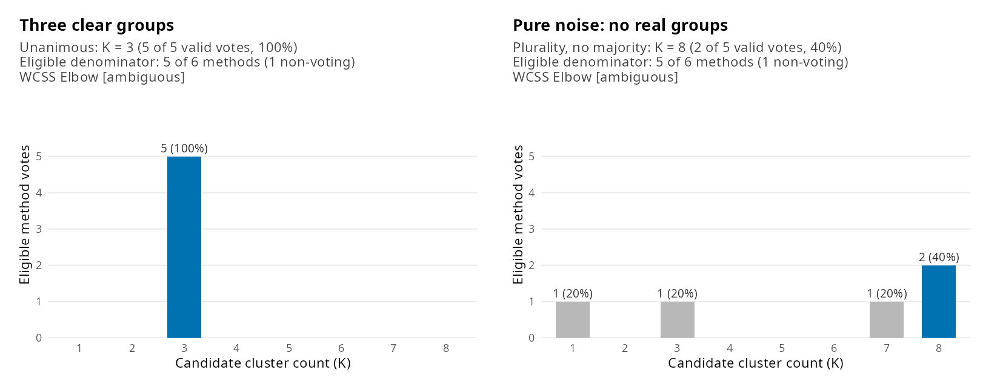

# kconsensus

<!-- badges: start -->
[](https://github.com/UZUB18/kconsensus/actions/workflows/R-CMD-check.yaml)
[](LICENSE.md)
<!-- badges: end -->

**Choose the number of clusters for K-means, and know how much to trust it.**

kconsensus runs six standard methods (silhouette, Calinski-Harabasz,
Davies-Bouldin, Dunn, the gap statistic and the elbow) on the same K-means
fits and counts their votes. Unlike tools that always return one number, it
tells you how strong the agreement is, and says so when there is no clear
answer.



## Install

``` r
# install.packages("remotes")
remotes::install_github("UZUB18/kconsensus")
```

## Quick start

``` r
library(kconsensus)

result <- kconsensus(scale(iris[, 1:4]), k = 2:10)
result
#> <kconsensus result>
#> Recommended K: 2  (unanimous: 5 of 5 valid votes, 100%)
#> Votes: K = 2 (5)
#> Use summary() for reasons and flags, and plot() for diagnostics.

summary(result)                  # each method's vote, margin and any warnings
plot(result)                     # vote chart
plot(result, type = "indices")   # every method's score across K
```

## Your own data, no coding

A ready-made script reads a CSV or Excel file, cleans it (skips text columns,
constant columns and rows with missing values), chooses K, and saves the plots,
a summary and your data with a `cluster` column next to the file.

``` r
file.copy(system.file("scripts", "find_k_for_my_data.R", package = "kconsensus"), "find_k.R")
file.edit("find_k.R")   # then click Source and pick your file
```

It ends with a plain answer such as `Use K = 3 (unanimous support from the methods).`

## Reading the answer

| Status | Meaning | What to do |
|---|---|---|
| `unanimous` | Every method chose the same K | Use it |
| `majority` | More than half chose it | Use it, after a look at the plots |
| `plurality` | Most votes, but no majority | Weak: inspect the plots before using it |
| `single_vote` | Only one method could vote | No agreement to assess |
| `tie` | Several K share the most votes | No answer; try another K range |
| `no_valid_votes` | No method could vote | No answer; see `summary()` |

**Flags** add warnings without changing the vote: `upper_boundary` (the winner
is the largest K you tested, so try more), `lower_boundary` (the winner is the
smallest K its voters could evaluate) and `single_cluster_vote` (the gap
statistic says the data may not split at all).

## Good to know

* **Choose your columns.** Only include variables that should define the
  groups; unrelated columns blur the clusters.
* **Scale first** when variables use different units: `kconsensus(scale(x))`.
  Nothing is standardized for you.
* **Agreement is not proof.** Methods can agree on noise or miss a very small
  group. Vote percentages describe agreement between methods, not the
  probability that K is right.
* **Big data?** The gap statistic is the slow part. For a first look use
  `B = 20`, or skip it with
  `methods = c("silhouette", "calinski_harabasz", "davies_bouldin", "elbow")`.
* **Reproducible:** `seed` fixes every random step without touching your
  session's random-number state.

<details>
<summary><b>The six methods</b></summary>

| Method | Chooses | Implementation |
|---|---|---|
| Silhouette | Highest average silhouette width | `cluster::silhouette()` |
| Calinski-Harabasz | Highest index | `clusterCrit::intCriteria()` |
| Davies-Bouldin | Lowest index | `clusterCrit::intCriteria()` |
| Dunn | Highest index | `clusterCrit::intCriteria()` |
| Gap statistic | `firstSEmax` rule; can choose K = 1 | `cluster::clusGap()` |
| Elbow (WCSS) | Strongest knee; votes only if you set `elbow_min_strength` | kconsensus |

A method abstains, and leaves the vote count, when its best score is an exact
tie, a score is undefined, or its calculation fails. `summary()` always gives
the reason.

</details>

<details>
<summary><b>Other ways to install</b></summary>

From a shared package file:

``` r
install.packages(c("cluster", "clusterCrit", "ggplot2", "withr"))
install.packages("kconsensus_0.1.0.tar.gz", repos = NULL, type = "source")
```

From a local copy of this repository:

``` r
devtools::install("path/to/kconsensus", upgrade = FALSE)
```

</details>

## Learn more

* `vignette("choosing-k", package = "kconsensus")`: one dataset where the
  methods agree, one where they do not, and what to conclude.
* [PROJECT_SHOWCASE.md](PROJECT_SHOWCASE.md) and [validation/](validation/):
  how it was built and tested, including 700 simulated datasets.

MIT licensed.
